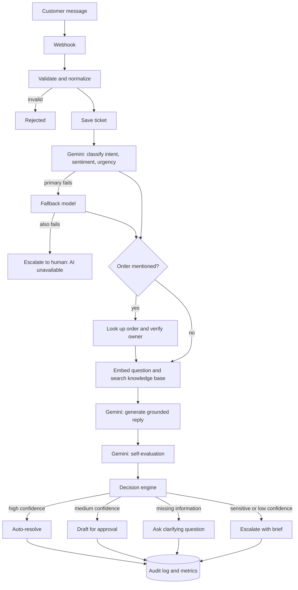

# Autonomous AI Support & Resolution Agent

An AI support agent that does more than write replies. For every customer message it **decides what to do**: resolve automatically, ask for clarification, send a draft for human approval, or escalate to a person. Each decision is explained, scored and stored in an audit trail.

Built with **n8n, Google Gemini, Supabase (PostgreSQL + pgvector), JavaScript and Docker**.

> Demo video: _add link_  |  Author: _your name_  |  Contact: _email or profile link_

---

## What it does

1. Receives customer messages through a secured webhook
2. Validates and normalizes the input, and rejects bad payloads
3. Classifies intent, sentiment, urgency and frustration (Gemini, structured JSON output)
4. Retrieves the customer's order and **verifies it belongs to that customer**
5. Searches the company knowledge base by meaning (RAG with pgvector)
6. Writes a personalized reply using only the retrieved facts
7. **Grades its own reply** with a second AI call (groundedness, policy, tone, confidence)
8. Applies a rule-based **decision engine** to choose the action
9. Escalates sensitive or low-confidence tickets with a ready-made hand-off brief and an SLA deadline
10. Logs every step, with token counts, to an audit table
11. Falls back to a second model, then to a human, if the AI service fails
12. Reports live metrics on a dashboard

## Architecture



## The key idea: the AI does not make the final call

Gemini produces scores and drafts. A readable JavaScript policy layer makes the decision, so the behaviour is predictable, testable and easy to change.

| Condition | Action |
|---|---|
| Legal, fraud or safety language | Escalate (critical priority, 1 hour SLA) |
| High frustration and high urgency | Escalate (high priority) |
| Order not found, or belongs to another customer | Escalate |
| Refund above the configured limit | Escalate for manager approval |
| Self-check flags policy or tone problems | Escalate |
| Not enough information to answer | Ask a clarifying question |
| Confidence at or above 0.85 and grounded | Auto-resolve |
| Confidence between 0.60 and 0.85 | Draft for human approval |
| Anything else | Escalate |

The reported confidence is never trusted on its own. It is capped by code-level checks (grounded answer, policy passed, enough evidence).

## Safety and reliability

- **Prompt-injection resistance:** customer text is treated as untrusted data in every prompt, and there is a test for it
- **Ownership check:** order details are only used when the order belongs to the customer who wrote in
- **Grounded replies:** the writer may only use retrieved facts, and the judge checks every claim against them
- **Duplicate protection:** a unique ticket ID rejects repeated webhook deliveries
- **Failure handling:** fallback model, then human escalation, plus a global error workflow that logs failures
- **Full audit trail:** each step, rule triggered, confidence and token usage is stored per ticket

## Tech stack

| Component | Technology |
|---|---|
| Automation | n8n |
| AI | Google Gemini (classification, generation, self-evaluation, embeddings) |
| Knowledge retrieval | RAG with pgvector in Supabase |
| Database | Supabase / PostgreSQL |
| Logic | JavaScript (n8n Code nodes) |
| Dashboard | Metabase |
| Testing | PowerShell test suite, Postman |
| Deployment | Docker Compose |

## Repository structure

```
ai-support-agent/
├── docker-compose.yml      n8n and Metabase
├── workflows/              n8n workflow exports (main and error handler)
├── sql/                    schema, sample data, metrics views
├── tests/                  run-tests.ps1 and the Postman collection
└── README.md
```

## Setup

1. **Start the tools**
   ```powershell
   docker volume create n8n_data
   docker volume create metabase_data
   docker compose up -d
   ```
   n8n runs at http://localhost:5678 and Metabase at http://localhost:3000.
2. **Create a Supabase project** and run the files in `sql/` in the SQL Editor (schema, sample data, metrics views).
3. **Create a Gemini API key** in Google AI Studio.
4. **In n8n,** add two credentials: a Supabase API credential (project URL and service role key) and a Header Auth credential named `Gemini API Key` (header name `x-goog-api-key`).
5. **Import the workflows** from `workflows/`, set the Error Workflow of the main workflow to the error handler, and publish both.
6. **Load the knowledge base:** run the ingestion workflow once to embed the policy documents.
7. **Send a ticket**
   ```powershell
   $body = @{ ticket_id="T-1"; email="anna@example.com"; name="Anna Perera"; message="Where is my order ORD-1001?" } | ConvertTo-Json
   Invoke-RestMethod -Method Post -Uri "http://localhost:5678/webhook/support-ticket" -ContentType "application/json" -Body $body
   ```

Never commit API keys or database passwords. Keep them in n8n credentials only.

## Testing

`tests/run-tests.ps1` sends 10 labeled tickets (normal questions, someone else's order, a refund over the limit, a legal threat, a missing order, an out-of-scope question, a prompt-injection attempt, and an angry urgent complaint) and prints a SQL query that compares each decision with the expected outcome.

**Latest run: 10 of 10 tickets produced an accepted decision.**

## Metrics dashboard

Metabase reads SQL views over the audit data: total tickets, auto-resolve rate, escalation rate, decisions by rule, tickets by intent, confidence by action and token usage per step.

## Making it yours (customization)

This is a template that can be adapted to a client's business:

- Replace the sample knowledge base with the client's documents
- Connect the order lookup to the client's real order system (Shopify, WooCommerce or a custom API)
- Deliver replies and escalations through their helpdesk (Zendesk, Freshdesk, Slack or email)
- Tune thresholds and keywords to their risk tolerance
- Add channels (email, chat widget, WhatsApp) in front of the same webhook

## Known limitations and roadmap

- The demo uses mock orders and a small sample knowledge base
- Replies are stored but not yet delivered through a real helpdesk
- Thresholds are set in the decision code; moving them to a config table would allow changes without editing the workflow
- Planned: a feedback loop that learns from human edits, multi-language evaluation, and per-ticket cost reporting

## Notes

- Model names may change; update the model in the Gemini nodes if a model is retired.
- This project is a demonstration and has not been audited for production use.
